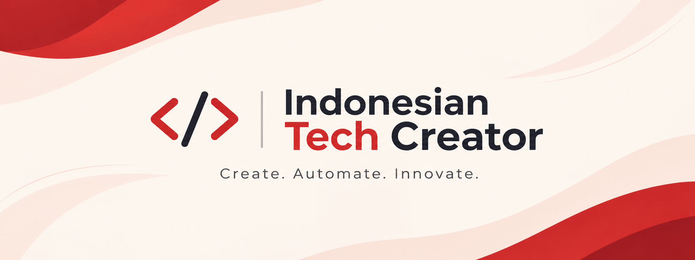

# Indonesian Tech Content Creator Skill

<p align="center">
  
</p>

[](https://opensource.org/licenses/MIT)
[](https://agentskills.io)
[](https://claude.ai)
[](https://openai.com)
[](https://cursor.sh)
[](http://makeapullrequest.com)

[](https://sociabuzz.com/zhaasyft/tribe)

Agent skill for Indonesian developers who want to become tech content creators. Full workflow: ideation → scripting → optimization → scheduling → monetization.

**Full open source. MIT License. Free to use, modify, and distribute.**

---

## ☕ Support This Project

If this skill is useful for you, you can support its development at:

**👉 [Sociabuzz Tribe](https://sociabuzz.com/zhaasyft/tribe)**

Every support means a lot to keep this project active and growing! 🙏

---

## 🎯 What This Does

This skill teaches AI agents (Claude Code, Cursor, Hermes, Codex, etc.) how to help you create tech content for Indonesian audience:

- **Content Ideation** — Generate 10-20 content ideas based on trending topics
- **Script Generation** — Write complete scripts for TikTok, YouTube, blog, Twitter
- **Title Optimization** — Optimize titles for Indonesian market (SEO + engagement)
- **Content Calendar** — Plan 2-4 weeks of content across platforms
- **Monetization Roadmap** — Strategy based on your follower count and niche

All with **Indonesian context**: local examples, Bahasa Indonesia tone, Indonesian market rates, local platforms (Tokopedia, Gojek, Biznet Gio, etc.)

## 🚀 Quick Start

### Install in Claude Code

```bash
# Clone this repo
git clone https://github.com/ezhasyafaat/indonesian-tech-creator-skill.git

# Copy to Claude skills folder
cp -r indonesian-tech-creator-skill ~/.claude/skills/

# Or use npx (once published)
npx skills add ezhasyafaat/indonesian-tech-creator-skill --skill '*' --agent claude-code
```

### Install in OpenAI Codex

```bash
# Using npx (recommended)
npx skills add ezhasyafaat/indonesian-tech-creator-skill --skill '*' --agent codex --global --yes

# Or manual install
git clone https://github.com/ezhasyafaat/indonesian-tech-creator-skill.git
cp -r indonesian-tech-creator-skill ~/.codex/skills/
```

### Install in OpenCode

```bash
# Using npx (recommended)
npx skills add ezhasyafaat/indonesian-tech-creator-skill --skill '*' --agent opencode --global --yes

# Or manual install
git clone https://github.com/ezhasyafaat/indonesian-tech-creator-skill.git
cp -r indonesian-tech-creator-skill ~/.opencode/skills/
```

### Install in Cursor

```bash
# In Cursor, go to: Customize → Plugins → Add → From GitHub Repository
# Enter: github.com/ezhasyafaat/indonesian-tech-creator-skill

# Or using npx
npx skills add ezhasyafaat/indonesian-tech-creator-skill --skill '*' --agent cursor --global --yes

# Or manually copy to Cursor skills folder
cp -r indonesian-tech-creator-skill ~/.cursor/skills/
```

### Install in Gemini CLI

```bash
# Using npx (recommended)
npx skills add ezhasyafaat/indonesian-tech-creator-skill --skill '*' --agent gemini-cli --global --yes

# Or manual install
git clone https://github.com/ezhasyafaat/indonesian-tech-creator-skill.git
cp -r indonesian-tech-creator-skill ~/.gemini/skills/
```

### Install in GitHub Copilot

```bash
# Using npx (recommended)
npx skills add ezhasyafaat/indonesian-tech-creator-skill --skill '*' --agent github-copilot --global --yes

# Or manual install
git clone https://github.com/ezhasyafaat/indonesian-tech-creator-skill.git
cp -r indonesian-tech-creator-skill ~/.copilot/skills/
```

### Install in Hermes Agent

```bash
# Using npx (recommended)
npx skills add ezhasyafaat/indonesian-tech-creator-skill --skill '*' --agent hermes-agent --global --yes

# Or manual install
git clone https://github.com/ezhasyafaat/indonesian-tech-creator-skill.git
cp -r indonesian-tech-creator-skill ~/.hermes/skills/
```

### Universal Install (All Platforms)

```bash
# Install to all supported agents at once
npx skills add ezhasyafaat/indonesian-tech-creator-skill --skill '*' --agent all --global --yes
```

## 💬 Usage Examples

### 1. Content Ideation

```
/indonesian-tech-creator ideation

Generate 10 tech content ideas for Indonesian developers this week.
Target audience: junior developers just starting their careers.
Focus: Web development.
```

**Output:**
```
📌 10 TECH CONTENT IDEAS THIS WEEK
Target: Indonesian Junior Developers | Focus: Web Dev

1. "5 VS Code Extensions Every Indonesian Developer Must Use"
   - Format: TikTok (30 seconds) + Blog
   - Hook: "Still coding without these extensions? You're missing out!"
   - Why trending: Developer tools always perform well
   - Unique angle: Review from Indonesian developer perspective

2. "How to Deploy Your First Website (Free!)"
   - Format: YouTube (8 minutes)
   - Hook: "Deploy your first website in 5 minutes, for free!"
   - Why trending: Many junior devs struggle with deployment
   - Unique angle: Use Vercel + affordable .my.id domain

... [8 more ideas]
```

### 2. Script Generation

```
/indonesian-tech-creator script

Create a 45-second TikTok script about "Git Tips That Senior Devs Use".
Style: Casual, like talking to a friend.
Target: Indonesian junior developers.
```

**Output:**
```
🎬 TIKTOK SCRIPT: Git Tips Senior Devs Use
Duration: 45 seconds | Style: Casual Indonesian

[0-3 seconds] HOOK
Visual: Close-up to camera, serious expression
Audio: "Still doing git add . for every file? Senior devs never do that."
Text overlay: "STOP git add ."

[3-15 seconds] TIP 1
Visual: Screen recording terminal
Audio: "Use git add -p. This is interactive staging..."
Text overlay: "git add -p = selective staging"

... [full script with timing]

---
📝 NOTES:
- Background music: Lo-fi beat, volume 20%
- Caption: "Git tips that senior devs use 🔥 #DeveloperIndonesia #Git"
- Post time: Tuesday 19:00 WIB
```

### 3. Title Optimization

```
/indonesian-tech-creator optimize-title

Topic: "Tutorial Deploying Node.js App to Indonesian Server"
Platform: YouTube
Target views: 10K+
```

**Output:**
```
🎯 YOUTUBE TITLE OPTIMIZATION

Topic: Deploy Node.js to Indonesian Server

TOP 5 TITLES (ranked by CTR potential):

1. "Deploy Node.js to Indonesian Server Only 50K/Month! (Complete Tutorial)"
   - Score: 9.2/10
   - Why: Specific price point + "complete tutorial" = trust

2. "Stop Using AWS! Deploy Node.js on Indonesian Server 80% Cheaper"
   - Score: 8.8/10
   - Why: Controversial hook + specific comparison

... [3 more titles]

---
📝 RECOMMENDED:
Title: #1 (highest CTR potential)
Thumbnail text: "DEPLOY NODE.JS\nONLY 50K!"
Tags: node.js, deploy, server indonesia, tutorial, murah
```

### 4. Content Calendar

```
/indonesian-tech-creator calendar

Buatkan content calendar 2 minggu untuk tech content creator.
Platforms: TikTok (daily), YouTube (2x/week), Blog (1x/week).
Niche: Web development untuk junior developer Indonesia.
```

**Output:**
```
📅 CONTENT CALENDAR: 2 MINGGU
Niche: Web Dev for Junior Dev Indonesia

WEEK 1:
┌─────────┬──────────────────────────────────────┬──────────┐
│ Day     │ Content                              │ Platform │
├─────────┼──────────────────────────────────────┼──────────┤
│ Senin   │ "5 VS Code Extensions Wajib"         │ TikTok   │
│ Selasa  │ Tutorial: Deploy Website Pertama     │ YouTube  │
│ Rabu    │ "Tips Debugging yang Jarang Diketahui"│ TikTok  │
│ Kamis   │ Quick tip: Console.table()           │ TikTok   │
│ Jumat   │ Blog: "Roadmap Belajar Web Dev 2025" │ Blog     │
│ Sabtu   │ Tutorial: Git Workflow               │ YouTube  │
│ Minggu  │ Weekly recap thread                  │ Twitter  │
└─────────┴──────────────────────────────────────┴──────────┘

... [Week 2]

---
📝 NOTES:
- Best posting times: TikTok 19:00-21:00 WIB, YouTube 15:00-17:00 WIB
- Content mix: 60% educational, 30% tips/tricks, 10% personal
```

### 5. Monetization Roadmap

```
/indonesian-tech-creator monetization

Aku punya 15K followers di TikTok, 5K di YouTube.
Niche: Web development tutorial.
Mau monetize, kasih roadmap.
```

**Output:**
```
💰 MONETIZATION ROADMAP

Your Stats:
- TikTok: 15K followers
- YouTube: 5K subscribers
- Niche: Web dev tutorials

CURRENT STAGE: Early Monetization (10K-50K followers)

---
✅ AVAILABLE NOW:

1. Affiliate Marketing
   - Niagahoster (hosting): Rp 50K-100K per sale
   - Domain ID: Rp 20-50K per sale
   - Estimated: Rp 500K-2K/bulan

2. TikTok Creator Fund
   - Requirement: 10K+ followers, 100K views/30 days
   - You: ✅ Qualified
   - Estimated: Rp 200-500K/bulan

3. YouTube AdSense
   - Requirement: 1K subs + 4K watch hours
   - Estimated: Rp 300K-1K/bulan

---
🎯 NEXT 3 MONTHS:
[Detailed roadmap with milestones]

---
📊 6-MONTH PROJECTION:
- Revenue: Rp 10-25K/bulan
- Sources: Affiliate (30%), AdSense (20%), Sponsorships (40%), Digital products (10%)
```

## 📁 Project Structure

```
indonesian-tech-creator-skill/
├── SKILL.md                          # Main skill file (workflows & instructions)
├── README.md                         # This file
├── LICENSE                           # MIT License
├── templates/
│   ├── tiktok-script-template.md     # TikTok script template
│   ├── youtube-script-template.md    # YouTube script template
│   ├── instagram-template.md         # Instagram (Reels, Carousels, Stories, Feed)
│   ├── blog-post-template.md         # Blog post template
│   └── content-calendar-template.md  # Content calendar template
├── workflows/
│   ├── content-ideation.md           # Detailed ideation workflow
│   ├── script-generation.md          # Script writing workflow
│   ├── title-optimization.md         # Title optimization workflow
│   ├── calendar-planning.md          # Calendar planning workflow
│   └── monetization-roadmap.md       # Monetization strategy workflow
└── references/
    ├── platform-guidelines.md        # Platform-specific guidelines
    ├── indonesian-tech-keywords.md   # Keywords & hashtags
    └── monetization-programs.md      # Indonesian affiliate programs
```

## 🎨 Features

### Indonesian Context
- **Local examples**: Gojek, Tokopedia, Traveloka, local startups
- **Bahasa Indonesia tone**: Casual, like talking to a friend
- **Indonesian market rates**: Realistic monetization estimates in Rupiah
- **Local platforms**: Biznet Gio, Niagahoster, DOKU, Xendit, QRIS
- **Cultural relevance**: Indonesian holidays, events, audience behavior

### Multi-Platform Support
- **TikTok**: Short-form video scripts (15-60 seconds)
- **YouTube**: Long-form tutorials (5-15 minutes)
- **Instagram**: Reels, Stories, carousels, feed posts
- **Blog**: SEO-optimized long-form articles
- **Twitter/X**: Threads and engagement posts

### Complete Workflow
1. **Ideation** → Generate content ideas based on trends
2. **Scripting** → Write complete scripts with timing/visuals
3. **Optimization** → Optimize titles, descriptions, hashtags
4. **Scheduling** → Plan content calendar
5. **Monetization** → Strategy based on your stats

## 🤝 Contributing

Contributions welcome! This is a community project for Indonesian tech creators.

See [CONTRIBUTORS.md](CONTRIBUTORS.md) for details on how to contribute.

**How to contribute:**
1. Fork this repo
2. Create your feature branch (`git checkout -b feature/amazing-feature`)
3. Commit your changes (`git commit -m 'Add amazing feature'`)
4. Push to the branch (`git push origin feature/amazing-feature`)
5. Open a Pull Request

**Areas for contribution:**
- Add more templates (Twitter thread, LinkedIn post, etc.)
- Improve workflows with more examples
- Add regional variations (Javanese, Sundanese content)
- Translate to English for broader audience
- Add automation scripts (analytics, scheduling)
- Share your success stories!

## 📄 License

MIT License — see [LICENSE](LICENSE) file for details.

**You can:**
- ✅ Use commercially
- ✅ Modify
- ✅ Distribute
- ✅ Use privately

**You must:**
- ✅ Include license and copyright notice

## 🙏 Acknowledgments

Built for the Indonesian developer community. Inspired by:
- Indonesian tech creators who share knowledge freely
- Open source community
- Agent Skills standard (agentskills.io)

## 📞 Contact

- **Author**: Ezha Syafaat
- **GitHub**: [@ezhasyafaat](https://github.com/ezhasyafaat)
- **Issues**: [Open an issue](https://github.com/ezhasyafaat/indonesian-tech-creator-skill/issues)

---